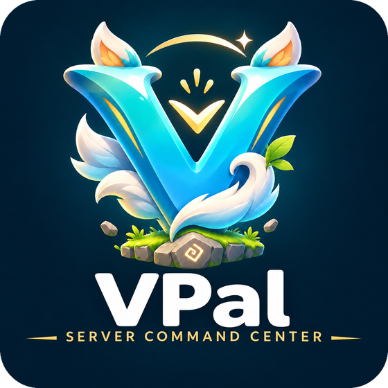

# VPal Server Command Center

A free control panel for running a **Palworld dedicated server on your own Windows PC**, made for families and small groups of friends, including console players.

> VPal is an unofficial fan tool. It is not made by, affiliated with, endorsed by or sponsored by Pocketpair, Inc. Palworld is a trademark of Pocketpair, Inc.

**Status: beta.** It runs a real family server every day, but expect rough edges. Please report problems on the [Issues](../../issues) tab.

**VPal is free.** It's built by one person in his spare time, so if it saves you some headaches, a tip on [Ko-fi](https://ko-fi.com/vpalhq) helps keep it going.

## What it does

- **Setup in one window.** It downloads the free Palworld Dedicated Server from Steam, writes its settings from a few questions, adds the firewall rules and shows exactly what to forward on your router.
- **Settings editor.** Every server setting explained, each with its own icon, Palworld's default beside it, and a backup on each save, under a starry-night look.
- **Watchdog.** Starts the server again after a crash or a freeze, restarts it with an in-game warning when memory runs high, installs game updates and waits for the ports to be free before starting.
- **Daily restarts** at the times you pick, with warnings in the game first.
- **Backups.** Zips the world every few hours and before restarts. Restore any backup after seeing who and what is in it, and a safety copy is always made first.
- **Players.** Who is online and everyone who has played, with playtime, plus kick, ban and a whitelist.
- **Discord bot.** Alerts in a channel you pick and slash commands (`/status`, `/players`, `/restart` and more). Free: you create the bot yourself and the control panel walks you through it.
- **Pal Planner.** A private website for your players with their own pals, breeding paths, a live map and a voice-chat button, each locked with the player's own code.
- **Ask.** Players type questions like "How do I breed Jetragon?" or "Who are my best miners?" and get answers from the game's own data and their own save. No AI and nothing made up, and it warns if the game has updated past VPal's data.
- **One-click updates** for VPal itself. The game server keeps running while VPal updates.

## Download

1. Open [Releases](../../releases/latest) and download **VPal-Setup.exe**.
2. Run it. Windows shows *"Windows protected your PC"* because VPal isn't code-signed yet: click **More info**, then **Run anyway**.
3. VPal opens and asks a few questions, then sets up the server (about a 6 GB download from Steam).

Already have a Palworld dedicated server? Pick its folder (the one with `PalServer.exe`) during setup and VPal uses it.

**Needs:** Windows 10 or 11 (64-bit) and about 7 GB free. Python is installed for you if it's missing.

## What it installs and changes

Everything is listed in [NOTICE.txt](NOTICE.txt). In short: VPal's files in the folder you pick, shortcuts, a scheduled task that keeps the watchdog running, and firewall rules for the game ports (Windows asks first). Tailscale and the Discord bot are only set up if you turn them on.

## Network and safety

- The watchdog and the Pal Planner's website only listen on your own PC.
- The server's REST API (port 8212) only answers on your PC. **Never forward port 8212 on your router.** Forward only UDP 8211 (and UDP 27015 to be listed in Community Servers).
- Once a day VPal checks this page for a newer version. Nothing about you or your server is sent, and updates only install when you click Update.
- Updates are checked against a SHA-256 fingerprint and may only contain VPal's own program files. Your settings, worlds, backups and player list are never part of an update.

## Uninstall

Settings > Apps > **VPal Server Command Center** > Uninstall. Your Palworld server, worlds, backups and settings stay in the folder, so nothing is lost by accident.

## Building from source

- `PalworldSettingsEditor.ps1` is the control panel (Windows PowerShell 5.1, WinForms).
- `CommandCenter/service/ui` is the control panel's look: `VPalUi.cs` (its custom-drawn controls, which the control panel compiles with Add-Type the first time it opens), the backdrop and the icons.
- `CommandCenter/service` is the watchdog (Python 3.9+, standard library plus psutil).
- `PalPlanner` is the save reader and the players' website.
- `build/` has the NSIS 3 installer scripts and `make_release.py`, which makes a release's update zip and `vpal-update.json`.

Releases also bundle these third-party libraries (Windows x64), which are not in this repository: psutil 7.0.0 in `CommandCenter/service/lib`, and PyCryptodome 3.23.0 and pyooz 0.0.8 in `PalPlanner/engine/lib`.

## Support VPal

VPal is free and always will be. If you'd like to say thanks, you can leave a tip at **[ko-fi.com/vpalhq](https://ko-fi.com/vpalhq)**. It's never required, and every feature stays free.

## License and credits

VPal is free software under the [GNU General Public License v3.0](LICENSE).

| Part | License |
| --- | --- |
| psutil 7.0.0 | BSD-3-Clause |
| PyCryptodome 3.23 | BSD-2-Clause, parts public domain |
| pyooz 0.0.8 (reads Palworld saves) | GPL-3.0-or-later |
| palsav, from PalworldSaveTools | MIT |
| Palworld Atlas data, PalDex data | MIT |
| PalworldSavePal data (breeding tables) | GPL-3.0 |
| Arkive game tables by Yihao Liu (tc-imba): recipes, technology, schematic drops and some map data | CC BY-NC 4.0 (non-commercial) |
| Leaflet (map) | BSD-2-Clause |

Their license files are in `PalPlanner/engine/licenses`. Pal and item artwork is Pocketpair's.

VPal's own code is GPL-3.0. The game data files keep their own licenses, and the Arkive-based data may only be used non-commercially. That's one reason VPal is free: tips are optional and never unlock anything.
